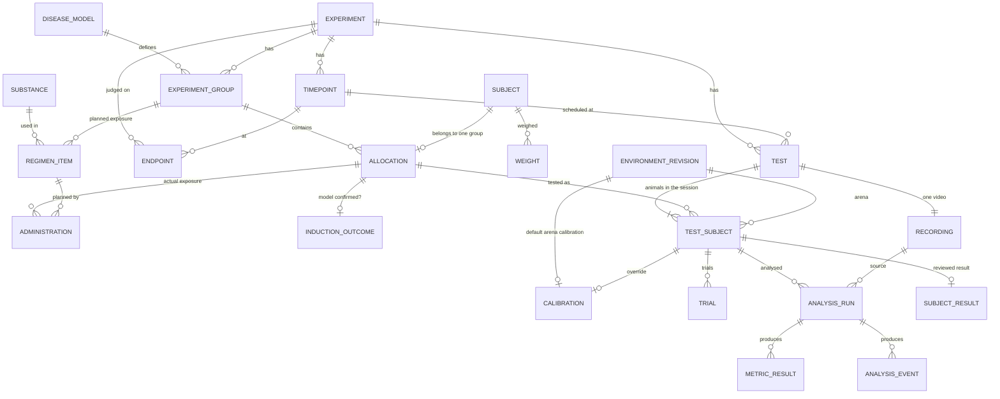

# Domain redesign: study design around groups, diseases and substances

Status: proposal, not implemented. Date: 2026-10-12.

## 1. How a preclinical mouse study actually works

A behavioural efficacy study answers one question: does substance X, at dose D,
reverse the deficit caused by disease model M? Everything else follows from
that question.

1. **Catalog (lab-wide, reused across studies)**
   - Substances: active compounds, reference drugs, vehicles (saline, 0.5% CMC,
     5% DMSO) and disease-inducing agents (MPTP, LPS, scopolamine, STZ).
   - Disease models: how a deficit is produced (chemical, surgical, diet,
     stress) and how it is confirmed.
   - Test paradigms and environments (already exist).
2. **Study design (decided before any animal is touched)**
   - Hypothesis and primary outcome metric.
   - Groups (arms). A group is *defined* by its disease model and its treatment
     regimen. Typical layout:

     | Group | Disease | Treatment | Purpose |
     |---|---|---|---|
     | Healthy control | none | vehicle | normal baseline |
     | Sham | sham procedure | vehicle | controls for the induction procedure itself |
     | Disease control | model M | vehicle | the deficit |
     | Positive control | model M | reference drug | proves the assay can detect rescue |
     | Treatment low / mid / high | model M | X at D1 / D2 / D3 | efficacy and dose response |

   - Timeline in study days relative to day 0 (usually induction): baseline
     tests, induction, dosing window, post-treatment tests.
   - Target n per group, randomisation and blinding method (ARRIVE 2.0
     items 1-5).
3. **Execution (per animal)**
   - Allocate each animal to one group (randomised), once.
   - Induce the disease, record the actual induction and whether the model was
     confirmed.
   - Weigh, dose according to the group's regimen (mg/kg uses the latest
     weight), record each actual administration.
   - Test each animal at each timepoint; record video; the worker analyses it.
   - Exclusions (death, failed induction, outlier criteria) are recorded with a
     reason, never deleted.
4. **Analysis (per study)**
   - The experimental unit is the animal. Per group, per timepoint, per metric:
     n, mean, SD, SEM.
   - Standard comparisons, all derived from group roles:
     - Model validity: disease control vs healthy control (and vs sham).
     - Assay sensitivity: positive control vs disease control.
     - Efficacy: each treatment group vs disease control.
     - Dose response: treatment groups of the same substance ordered by dose.
     - Rescue %: (treated - disease control) / (healthy control - disease
       control) x 100.
     - Time course: the same comparisons across timepoints.

This matches the CDISC SEND trial design split: trial sets (groups with their
treatment and dose), trial elements and arms (the planned sequence of
induction and dosing), demographics (animals on study) and exposure (actual
dosing), with findings recorded separately.

## 2. What is wrong with the current model

| Problem | Where | Effect |
|---|---|---|
| A group is only a name and `CONTROL`/`TREATMENT` | `experiment_groups` | "Which disease, which substance, which dose" is not part of the group. Reports cannot answer "by substance" or "by dose". |
| Two control roles only | `experiment_groups.role` | Healthy, sham, disease (vehicle) and positive controls are indistinguishable, so model validity and efficacy comparisons cannot be computed automatically. |
| Disease is recorded per animal, not designed per group | `subject_conditions` | The design never says which groups are diseased; a disease control is just a name. |
| Induction is not an exposure | `subject_conditions` vs `administrations` | MPTP or LPS injections are dosing events, but they are recorded as a status change without agent, dose or route. |
| Treatment plan is optional and loosely tied | `intervention_plans` | A plan has a free-text schedule and an optional phase; dose level is not a group property, so dose response cannot be derived. |
| Time-varying group membership | `group_assignments` (GiST exclusion) | Built for crossover designs the lab does not run; every query has to resolve "group at time T". |
| Phases without days | `experiment_phases` | "Baseline" and "Week 2" have no study day, so the timeline cannot be drawn or checked. |
| No exclusion record | `enrollments` | ARRIVE requires exclusions with reasons; today an animal can only be deleted or silently ignored. |
| Reports group by group name only | `report_tests` view | No disease, substance, dose or role dimension reaches the analysis. |

## 3. Proposed model



Hierarchy in one line each:

- An **experiment** has groups, timepoints, endpoints and tests.
- A **subject** (animal) belongs to exactly one group, so to one experiment.
- A **test** belongs to one experiment and is one session: one timepoint, one
  protocol step, **one video**, and one or more animals, each in its own arena
  (environment). Usually one animal; sometimes up to three arenas in one frame.
- Every animal in a test is analysed and reviewed separately.

### Catalog

**substances** (exists, extended)
- `name`, `description`
- `kind`: `COMPOUND` | `VEHICLE` | `INDUCER` | `REFERENCE_DRUG`. A hint for
  pickers only; the role of a substance in a study comes from where it is used.

**disease_models** (exists, extended)
- `name`, `description`
- `induction_type`: `CHEMICAL` | `SURGICAL` | `DIET` | `STRESS` | `OTHER`
- `confirmation_criterion`: free text, e.g. "rotarod latency < 50% of baseline"
  (an automatic, metric-based confirmation is a later option, see section 3.1)

### Study design

**experiments** (exists, extended)
- `code`, `title`, `description`
- `hypothesis`; the outcomes it is judged on are `endpoints` (below)
- `status`: `DRAFT` | `RUNNING` | `COMPLETED`. Design tables are editable only
  in `DRAFT`; allocation and execution only in `RUNNING`.
- `randomisation` (text), `blinded` (bool)
- `requires_control` is replaced by role rules (below).

**experiment_groups** (exists, redefined)
- `code` (G1, G2...), `name`, `target_size`
- `role`: `HEALTHY_CONTROL` | `SHAM` | `DISEASE_CONTROL` | `POSITIVE_CONTROL` | `TREATMENT`
- `disease_model_id`: NULL only for `HEALTHY_CONTROL`, required otherwise
  (enforced by CHECK).
- Starting a study requires at least one `DISEASE_CONTROL` when any group has a
  disease, and every `TREATMENT`/`POSITIVE_CONTROL` group must share the
  disease model of a `DISEASE_CONTROL` group.

**regimen_items** (replaces `intervention_plans`): what a group receives.
- `group_id`, `purpose`: `INDUCTION` | `TREATMENT` | `VEHICLE`
- `substance_id`, `dose_micro`, `unit` (mg/kg, ug/kg, mL/kg, ...), `route`
- `frequency`: `ONCE` | `DAILY` | `TWICE_DAILY` | `WEEKLY` | `EVERY_N_DAYS` (+ `interval_days`)
- `start_day`, `end_day` (study days)
- A group's *dose level* is its `TREATMENT` item; dose response is the set of
  `TREATMENT` groups that share a substance.

**timepoints** (replaces `experiment_phases`)
- `name` (Baseline, Day 7, Day 14), `study_day`, `position`
- Day 0 is a property of the experiment (`day_zero` date, set when it starts).

**protocols / protocol_versions / protocol_steps**: unchanged (the test battery
per timepoint).

**endpoints**: what the study is judged on, chosen from the metrics of the
paradigms in its protocols.
- `experiment_id`, `timepoint_id`, `paradigm_key`, `metric_key`
- `kind`: `PRIMARY` | `SECONDARY` (exactly one primary)
- `direction`: `HIGHER_IS_BETTER` | `LOWER_IS_BETTER` (needed for rescue %)
- `baseline_timepoint_id` (optional): report change from baseline per animal

### Execution

**allocations** (replaces `enrollments` + `group_assignments`)
- `experiment_id`, `subject_id`, `group_id`, `allocated_at`
- unique (subject): an animal belongs to exactly one group, so to one study
- `excluded_at`, `exclusion_reason`: `DIED` | `HUMANE_ENDPOINT` |
  `INDUCTION_FAILED` | `TECHNICAL` | `OTHER` + `exclusion_note`
- `cage` (optional, for ARRIVE confounder reporting)

**administrations** (exists, re-keyed): every actual exposure, including the
disease induction and vehicle doses.
- `allocation_id`, `regimen_item_id` (planned item, nullable for unplanned),
  substance snapshot, actual dose, weight snapshot, route, `administered_at`,
  `recorded_by`

**induction_outcomes** (replaces `subject_conditions`)
- `allocation_id`, `status`: `CONFIRMED` | `NOT_CONFIRMED`, `assessed_at`,
  `note`. Induction itself is an administration with purpose `INDUCTION`;
  this row is only the confirmation.

**weights**: unchanged (`weight_measurements`).

**tests** (redefined): one session of one experiment.
- `experiment_id`, `timepoint_id`, protocol version + step (paradigm, trial
  count), `scheduled_at`, `status`, `notes`
- no animal and no environment on the test itself; those are per participant

**test_subjects** (new): the animals filmed in a test.
- `test_id`, `allocation_id`, `environment_revision_id` (the arena)
- an animal appears once per test, an arena holds one animal per test, the
  allocation belongs to the test's experiment, and the arena's paradigm is the
  test's paradigm
- trials, calibration overrides, analysis runs and the reviewed result hang
  off the participant, not the test

**recordings, calibrations, analysis runs, metric results, events**: kept; see
3.1 for how they plug into the study.

### 3.1 Video analysis inside the study

The video pipeline already exists (upload, calibration, worker, metric engine).
What is missing is the link from a metric value back to the scientific
question. The chain becomes:

```
experiment -> test (session: timepoint x protocol step) -> recording (one video)
                \-> test subject (animal + arena) -> calibration (arena default or override)
                      -> analysis run -> metric results + events (+ analysed video, trajectory)
                        -> subject result (human review) -> endpoint
experiment -> group (role, disease, substance, dose) -> allocation (animal)
  ... joined to the test subject by allocation for every group comparison
```

1. **Test = one session.** A test belongs to one experiment, one timepoint and
   one protocol step, and has exactly one video. The animals in it are its
   test subjects, each in a different arena (environment revision). Animals of
   different groups may share a session, which also helps blinding and
   counterbalancing. The group of a measurement always comes from the animal's
   allocation; nothing about the group is copied onto the test or the run.
2. **Recording and calibration.** One video belongs to one test
   (`UNIQUE (test_id)` and `UNIQUE (video_asset_id)` on `test_recordings`; a
   replacement upload supersedes the old recording, which is kept for
   provenance). Each animal's region in the frame comes from a calibration:
   - by default the calibration of its arena's environment revision, which
     already stores that arena's crop and transform for a fixed camera;
   - an override per test subject when the camera moved (calibration chains
     become `coalesce(test_subject_id, environment_revision_id)` instead of
     `coalesce(recording_id, environment_revision_id)`);
   - the worker contract barely changes: one run per test subject, each run
     gets the shared video plus its own crop and transform. A three-arena video
     is decoded three times; one multi-arena run is a later optimisation.
3. **Analysis runs** are queued automatically only for experiments in
   `RUNNING` or `COMPLETED`, one per test subject, never for an excluded animal,
   and never when the paradigm has no capable worker. Re-analysis (new engine version, new
   calibration) creates a new run; old runs stay for provenance.
4. **Subject result (new, `subject_results`).** Today "the result" of a test
   is implicitly the latest successful run. A study needs an explicit, human
   decision (decided 2026-10-12: every result is approved by a person):
   - `test_subject_id` (primary key), `run_id`, `status`: `PENDING` | `ACCEPTED` |
     `REJECTED`, `reason` (`TRACKING_LOST`, `WRONG_ANIMAL`, `VIDEO_DEFECT`,
     `PROTOCOL_DEVIATION`, `OTHER`), `note`, `reviewed_by`, `reviewed_at`.
   - The first successful run of a test subject creates the row as `PENDING`. Only
     `ACCEPTED` results enter statistics; reports show how many are still
     pending per group so a half-reviewed report is never mistaken for a final
     one.
   - The review queue shows the analysed video with the trajectory, the QC
     flags and the metrics; the reviewer accepts or rejects with a reason.
     Accepting several clean results at once is allowed.
   - A newer run (new engine version or calibration) does not replace an
     accepted result; the reviewer sees "newer run available" and may switch,
     which sends that animal's result back to review.
   - Rejected measurements are excluded from statistics but stay visible, the
     same way excluded animals are.
   - In a `blinded` study the review screen shows only animal, arena and test codes,
     never the group, dose or substance. The automatic analysis is blind by
     construction.
5. **Endpoints and comparisons.** For each endpoint (timepoint + metric) the
   report takes the accepted result of every non-excluded animal and computes:
   - per group: n, mean, SD, SEM, and change from baseline when the endpoint
     has a baseline timepoint;
   - model validity: disease control vs healthy control (and vs sham);
   - assay sensitivity: positive control vs disease control;
   - efficacy: each treatment group vs disease control, with rescue %
     (direction-aware);
   - dose response: treatment groups of one substance ordered by dose;
   - time course: the same per timepoint.
   Statistical tests (t-test, ANOVA with post hoc) come after the first version
   matches the lab's spreadsheets.
6. **Induction confirmation from video (later).** A disease model's criterion
   can become a metric rule ("endpoint X at timepoint Y below Z% of the
   animal's baseline"); `induction_outcomes` is then filled from accepted test
   results instead of by hand.
7. **Experiment completion.** `RUNNING` -> `COMPLETED` requires every planned
   test to be cancelled or every animal in it to have an `ACCEPTED` or
   `REJECTED` result, so a report never silently
   misses animals. Completing freezes the accepted results; a later engine
   version can still be run, but the frozen report records which versions it
   used (the reports context already tracks engine and schema versions).

`report_tests` gains `group_code`, `group_role`, `disease_model`,
`treatment_substance`, `treatment_dose`, `treatment_unit`, `timepoint`,
`study_day`, `arena`, `excluded`, is keyed by test subject instead of test, and
reads the accepted run from `subject_results` instead of "latest run".

## 4. Decisions (2026-10-12)

1. Production holds no study data worth keeping: the design tables are replaced,
   not migrated.
2. A subject belongs to exactly one group (so to one experiment) and never
   changes group.
3. One active substance per treatment group: a `TREATMENT` or
   `POSITIVE_CONTROL` group has exactly one `TREATMENT` regimen item, so every
   such group has one dose level.
4. All disease models are induced (no transgenic lines): `GENETIC` is not an
   induction type, and every diseased group except sham has an `INDUCTION` item.
5. One video belongs to one test, a test belongs to one experiment, and a test
   may film several animals, each in its own arena (usually one, sometimes
   up to three) (section 3.1, items 1-2). (2026-10-13)
6. Every analysis result is approved by a person before it counts
   (section 3.1, item 4).

## 5. Schema draft (migration 015)

Kept as is: `users`, `laboratories`, `subjects`, `weight_measurements`,
`environments` and revisions, paradigms (code), calibrations of environments.

Removed with their data: `experiment_phases`, `enrollments`,
`group_assignments`, `intervention_plans`, `subject_conditions`, and every
row that hangs off an experiment (`protocols`, `tests`, `trials`,
`test_comments`, `test_recordings`, recording calibrations, `analysis_runs`).
Video objects already in the bucket become orphans and are removed with a
bucket lifecycle rule or a one-off cleanup.

```sql
-- Catalog
ALTER TABLE misko.substances
    ADD COLUMN kind text NOT NULL DEFAULT 'COMPOUND'
        CHECK (kind IN ('COMPOUND', 'VEHICLE', 'INDUCER', 'REFERENCE_DRUG'));
ALTER TABLE misko.disease_models
    ADD COLUMN induction_type text NOT NULL DEFAULT 'CHEMICAL'
        CHECK (induction_type IN ('CHEMICAL', 'SURGICAL', 'DIET', 'STRESS', 'OTHER')),
    ADD COLUMN confirmation_criterion text CHECK (char_length(confirmation_criterion) BETWEEN 1 AND 2000);

-- Study design
ALTER TABLE misko.experiments
    DROP COLUMN requires_control,
    ADD COLUMN hypothesis text CHECK (char_length(hypothesis) BETWEEN 1 AND 2000),
    ADD COLUMN status text NOT NULL DEFAULT 'DRAFT' CHECK (status IN ('DRAFT', 'RUNNING', 'COMPLETED')),
    ADD COLUMN day_zero date,                       -- set when the study starts
    ADD COLUMN randomisation text CHECK (char_length(randomisation) BETWEEN 1 AND 500),
    ADD COLUMN blinded boolean NOT NULL DEFAULT false,
    ADD CONSTRAINT experiments_started_check CHECK ((status = 'DRAFT') = (day_zero IS NULL));

experiment_groups
    id, experiment_id, code ('G1'), name, target_size, description
    role             text  CHECK role IN ('HEALTHY_CONTROL', 'SHAM', 'DISEASE_CONTROL',
                                          'POSITIVE_CONTROL', 'TREATMENT')
    disease_model_id uuid  REFERENCES disease_models
    CHECK ((role = 'HEALTHY_CONTROL') = (disease_model_id IS NULL))
    UNIQUE (experiment_id, lower(code)), UNIQUE (experiment_id, lower(name))

regimen_items                                   -- planned exposure of a group
    id, experiment_id, group_id                 -- composite FK to the group
    purpose       text   CHECK IN ('INDUCTION', 'TREATMENT', 'VEHICLE')
    substance_id  uuid   REFERENCES substances
    dose_micro    bigint CHECK > 0
    unit          text   CHECK IN ('mg/kg', 'ug/kg', 'mL/kg', 'IU/kg', 'mg', 'ug', 'mL', 'uL', 'IU')
    route         text   CHECK IN (current route list)
    frequency     text   CHECK IN ('ONCE', 'DAILY', 'TWICE_DAILY', 'WEEKLY', 'EVERY_N_DAYS')
    interval_days int    CHECK ((frequency = 'EVERY_N_DAYS') = (interval_days IS NOT NULL))
    start_day     int, end_day int              -- study days; ONCE => start = end
    CHECK (end_day >= start_day)
    UNIQUE (group_id) WHERE purpose = 'TREATMENT'   -- one dose level per group

timepoints
    id, experiment_id, name ('Baseline', 'Day 7'), study_day int, position
    UNIQUE (experiment_id, position), UNIQUE (experiment_id, lower(name))

-- Execution
allocations                                     -- replaces enrollments + group_assignments
    id, experiment_id, subject_id, group_id     -- composite FK to the group
    allocated_at, cage text
    excluded_at, exclusion_reason CHECK IN ('DIED', 'HUMANE_ENDPOINT',
        'INDUCTION_FAILED', 'TECHNICAL', 'OTHER'), exclusion_note
    CHECK ((excluded_at IS NULL) = (exclusion_reason IS NULL))
    UNIQUE (subject_id)                         -- one group, ever

administrations                                 -- actual exposure, re-keyed
    id, experiment_id, allocation_id, regimen_item_id (nullable, composite FK)
    purpose, substance_id + substance_name snapshot
    dose_micro, unit, route, weight_measurement_id + body_milligrams snapshot
    administered_at, recorded_by
    CHECK (unit NOT LIKE '%/kg' OR weight_measurement_id IS NOT NULL)

endpoints
    id, experiment_id, timepoint_id, paradigm_key, metric_key
    kind CHECK IN ('PRIMARY', 'SECONDARY'), direction CHECK IN ('HIGHER_IS_BETTER', 'LOWER_IS_BETTER')
    baseline_timepoint_id (nullable)
    UNIQUE (experiment_id) WHERE kind = 'PRIMARY'

tests                                           -- one session of one experiment
    id, experiment_id, timepoint_id (composite FKs), protocol_version_id, step_position
    paradigm_key, paradigm_version, planned_trials, status, scheduled_at, ..., notes
    -- enrollment_id, subject_id, phase_id, group_id, environment_revision_id are gone

test_subjects                                   -- animals filmed in a test
    id, experiment_id, test_id, allocation_id, environment_revision_id
    FOREIGN KEY (experiment_id, test_id)       REFERENCES tests (experiment_id, id)
    FOREIGN KEY (experiment_id, allocation_id) REFERENCES allocations (experiment_id, id)
    UNIQUE (test_id, allocation_id), UNIQUE (test_id, environment_revision_id)

test_recordings                                 -- exactly one active video per test
    UNIQUE (video_asset_id)                     -- kept: a video belongs to one test
    + superseded_by uuid; UNIQUE (test_id) WHERE superseded_by IS NULL

trials, calibrations (override), analysis_runs, analysis_events
    + test_subject_id; runs keep test_id and recording_id as today

subject_results                                 -- the run that counts for one animal in a test
    test_subject_id PRIMARY KEY, run_id (composite FK to that participant's runs)
    status CHECK IN ('PENDING', 'ACCEPTED', 'REJECTED'), reason, note, reviewed_by, reviewed_at
    CHECK ((status = 'REJECTED') = (reason IS NOT NULL))
    CHECK ((status = 'PENDING') = (reviewed_by IS NULL))

induction_outcomes                              -- replaces subject_conditions
    allocation_id PRIMARY KEY, status CHECK IN ('CONFIRMED', 'NOT_CONFIRMED'),
    assessed_at, note, recorded_by
```

### Rules the database cannot express (checked when a study starts)

`DRAFT` -> `RUNNING` requires:

- at least one timepoint and one group, and each group's `target_size` set;
- exactly one primary endpoint, whose metric belongs to a paradigm used by the
  study's protocols;
- `TREATMENT` and `POSITIVE_CONTROL` groups: exactly one `TREATMENT` item and an
  `INDUCTION` item;
- `DISEASE_CONTROL`: an `INDUCTION` item, a `VEHICLE` item, no `TREATMENT` item;
- `SHAM`: a `VEHICLE` item standing in for the induction, no `INDUCTION` or
  `TREATMENT` item;
- `HEALTHY_CONTROL`: no `INDUCTION` or `TREATMENT` item;
- every `SHAM`, `TREATMENT` and `POSITIVE_CONTROL` group has a
  `DISEASE_CONTROL` group with the same disease model to be compared against.

Adding an animal to a test (any time while `RUNNING`) checks that it is not
excluded, is not already in another test of the same timepoint and protocol
step, and that its arena runs the test's paradigm.

Starting sets `day_zero` and freezes groups, regimens and timepoints. Animals
can be allocated in `DRAFT` and `RUNNING`; administrations, induction
outcomes, weights and tests only in `RUNNING`. `COMPLETED` is read-only.

## Sources

- CDISC SEND trial design and foundation domains (TS, TX, TA, TE, DM, EX):
  https://advance.phuse.global/x/i4JC,
  https://intuitionlabs.ai/articles/send-datasets-fda-nonclinical-submissions
- ARRIVE 2.0 Essential 10 (study design, sample size, exclusions,
  randomisation, blinding): https://arriveguidelines.org
